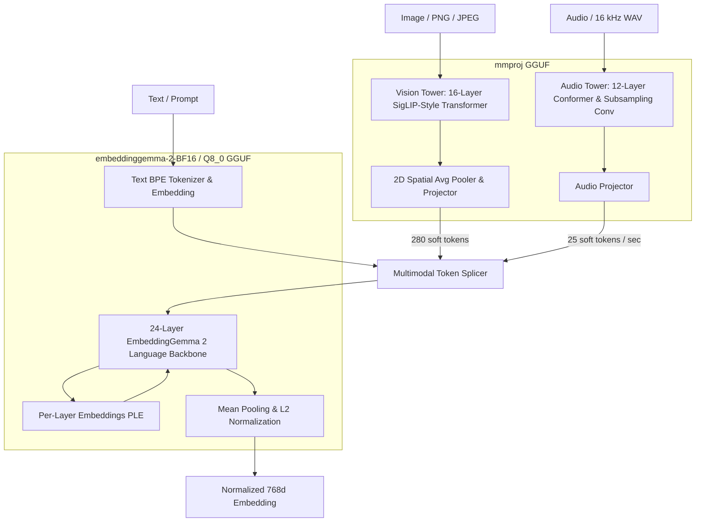

# Multimodal Projector (`mmproj`) Architecture & Implementation

`glypr` implements native, zero-overhead support for multimodal embeddings via dynamic attachment of **`mmproj-embeddinggemma-2-*.gguf`**.

When attached, `glypr` can directly ingest raw images and audio waveforms, map them through independent vision and audio encoder towers, and seamlessly splice soft tokens into the EmbeddingGemma 2 language backbone—all within a single self-contained Rust runtime.

---

## 1. Zero-Overhead Modular Architecture

A fundamental design constraint of `glypr` is **100% zero runtime and memory overhead for text-only workloads**:



- When `mmproj` is **unattached**, only the text backbone is loaded in VRAM/RAM (~540 MB for Q8_0, ~781 MB for BF16).
- When `attach_multimodal_projector(&path)` is called, the 963 multimodal weight tensors (~1.3 GB) are indexed and allocated on the target device on-demand.

---

## 2. Vision Pipeline (`VisionTower`)

The Vision Tower extracts high-level semantic representations from raw image pixels:

1. **Input Normalization:**
   Images are resized to $224 \times 224$ (RGB). Each pixel $x \in [0, 1]$ undergoes SigLIP normalization:
   $$\text{norm}(x) = 2 \cdot (x - 0.5) = 2x - 1 \in [-1, 1]$$
2. **Patch Embedder:**
   $16 \times 16$ non-overlapping patches ($14 \times 14 = 196$ patches). In GGUF, weights are formatted as `[768, 3, 16, 16]`, which `glypr` transposes to `[768, 16, 16, 3]` and projects to 768 dimensions.
3. **2D Axial Rotary Positional Embedding (RoPE):**
   Unlike 1D RoPE, Gemma 4 Vision uses 2D axial RoPE with base $\theta = 100$:
   - First half of head dimension ($[0, 32)$) encodes the horizontal ($X$) patch coordinate.
   - Second half of head dimension ($[32, 64)$) encodes the vertical ($Y$) patch coordinate.
4. **16-Layer Transformer Encoder:**
   16 Pre-LN Transformer layers featuring $Q/K$ RMSNorm, GeGLU feedforward networks, and full bidirectional attention.
5. **2D Spatial Pooling & Output Projection:**
   A $3 \times 3$ 2D spatial average pooler reduces spatial resolution to produce exactly **280 soft tokens** per image, followed by projection from 768 to 512 dimensions.

---

## 3. Audio Pipeline (`AudioTower`)

The Audio Tower processes raw 16 kHz mono waveforms into dense auditory representations:

1. **Log-Mel Spectrogram Extraction:**
   - Sample rate: 16,000 Hz, STFT frame length: 320 (20 ms), hop length: 160 (10 ms), FFT size: 512.
   - Periodic Hann analysis window with 160-sample semicausal left padding.
   - 128-channel HTK triangular Mel filterbank spanning 0 Hz to 8,000 Hz.
   - Log compression: $\log(\text{mel} + 0.001)$. 1 second of audio produces 99 time frames.
2. **2-Stage Subsampling Convolution:**
   Two successive Conv2D layers (stride 2, padding 1) with channel dimensions $1 \to 128 \to 32$, downsampling the time axis $4\times$ to yield **25 frames per second** (512 dimensions).
3. **12 Conformer Encoder Blocks:**
   Conformer architecture combining:
   - **Macaron FeedForward 1:** Pre-LN $\to$ Up-Proj $\to$ SiLU $\to$ Down-Proj $\to$ Post-LN $\times 0.5$.
   - **Chunked Self-Attention:** Chunk size 12, context window 24 (12 past, 0 future). Relative sinusoidal positional bias with relative shift `_rel_shift`.
   - **Lightweight Conv 1D:** Pre-LN $\to$ Pointwise Linear $\to$ GLU $\to$ Causal Depthwise Conv1D (kernel 5) $\to$ Conv-LN $\to$ SiLU $\to$ Pointwise Linear.
   - **Macaron FeedForward 2:** Post-layer scale 0.5.
   - **Gemma 4 Clippable Linears:** Every linear operator in all 12 blocks enforces scalar activation clipping bounds (`input_min`, `input_max`, `output_min`, `output_max`) stored directly in GGUF.
4. **Audio Projection:**
   Linear projection from 1536 to 512 dimensions, matching the language model hidden size.

---

## 4. Sequence Assembly & Backbone Forwarding

To embed multimodal queries, `glypr` formats the token sequence using official EmbeddingGemma 2 vocabulary delimiters:

- **Image Query Template:**
  $$\langle\text{bos}\rangle\ \langle\text{boi}\rangle\ \underbrace{\langle\text{image}\rangle \dots \langle\text{image}\rangle}_{280\text{ tokens}}\ \langle\text{eoi}\rangle\ \text{[Optional Prompt]}\ \langle\text{eos}\rangle$$
- **Audio Query Template:**
  $$\langle\text{bos}\rangle\ \langle\text{boa}\rangle\ \underbrace{\langle\text{audio}\rangle \dots \langle\text{audio}\rangle}_{25\text{ tokens / sec}}\ \langle\text{eoa}\rangle\ \text{[Optional Prompt]}\ \langle\text{eos}\rangle$$

Tokens in the placeholder slots ($\langle\text{image}\rangle$ / $\langle\text{audio}\rangle$) are replaced with the soft tokens produced by the respective tower. The merged sequence is forwarded through the 24-layer language backbone with Per-Layer Embeddings (PLE) and mean-pooled across all valid tokens to produce the final 768d unit vector.

---

## 5. Golden Parity Scorecard

Validated against official Python `SentenceTransformer("google/embeddinggemma-2")` on the deterministic test suite:

| Test Case | Input Modality | Prompt Text | Soft Tokens | Total Seq Len | Target | Measured Cosine Similarity | Status |
| :--- | :--- | :--- | :---: | :---: | :---: | :---: | :---: |
| **Case 1** | Image Only | *None* | 280 | 284 | $> 0.999$ | **0.999829** | ✅ **PASSED** |
| **Case 2** | Image + Prompt | `"Describe this picture"` | 280 | 288 | $> 0.999$ | **0.999719** | ✅ **PASSED** |
| **Case 3** | Audio Only | *None* | 25 | 29 | $> 0.999$ | **0.999644** | ✅ **PASSED** |
| **Case 4** | Audio + Prompt | `"A musical sound"` | 25 | 32 | $> 0.999$ | **0.999852** | ✅ **PASSED** |

Execution time for the entire 4-case multimodal validation suite: **6.77 seconds** on Apple Silicon Metal.

---

## 6. CLI Usage

Generate embeddings for images and audio directly using the `glypr` CLI with natural positional arguments:

```bash
# 1. Image embedding with prompt query (auto-resolves mmproj, Metal device, and Flash attention)
glypr embed "Describe this picture:" ./scene.png

# 2. Audio embedding without prompt
glypr embed ./recording.wav

# 3. Audio embedding with prompt and Matryoshka dimension truncation (256d)
glypr embed "Acoustic instruments:" ./acoustic_guitar.wav --dim 256

# 4. Custom vision budget (e.g. 140 tokens for native 480x680 card images, 280 default, 560 high-detail)
glypr embed ./card.png --image-token-budget 140
```
