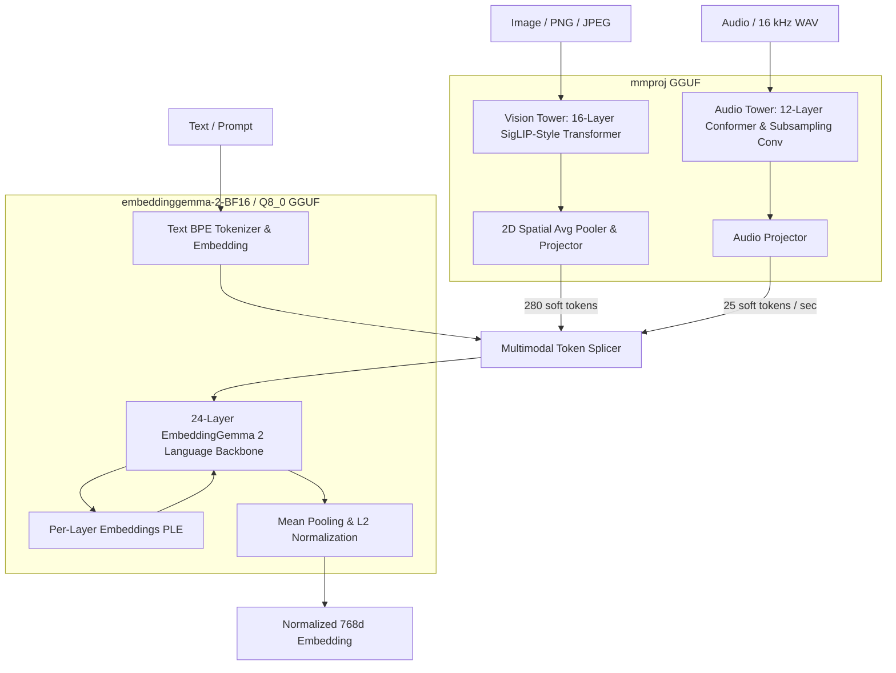
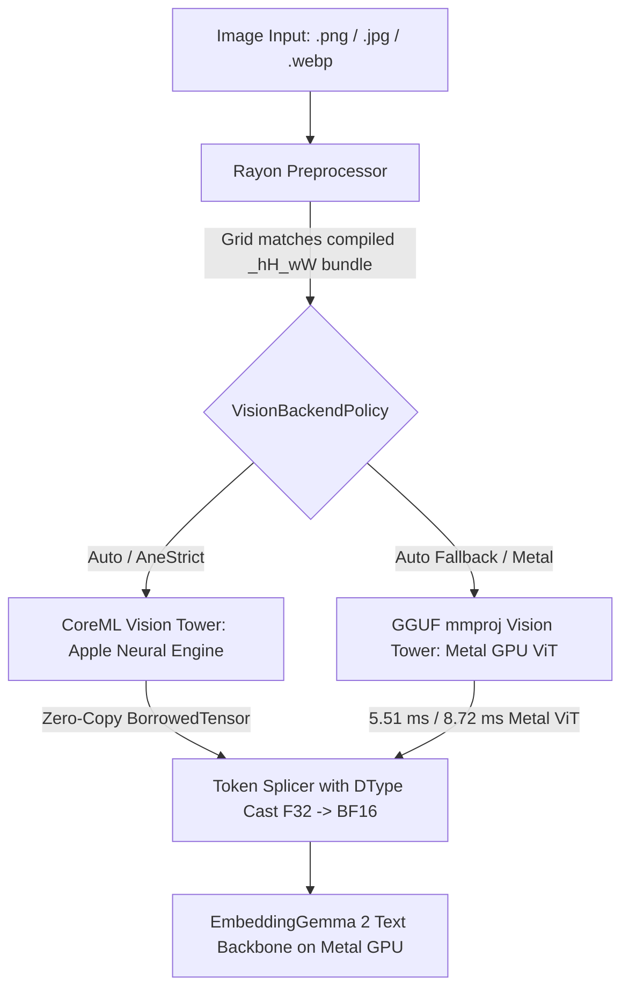

# Multimodal Projector (`mmproj`) Architecture & Implementation

`glypr` implements native, zero-overhead support for multimodal embeddings via dynamic attachment of **`mmproj-embeddinggemma-2-*.gguf`**.

When attached, `glypr` can directly ingest raw images and audio waveforms, map them through independent vision and audio encoder towers, and seamlessly splice soft tokens into the EmbeddingGemma 2 language backbone—all within a single self-contained Rust runtime.

---

## 1. Zero-Overhead Modular Architecture

A fundamental design constraint of `glypr` is **100% zero runtime and memory overhead for text-only workloads**:



- When `mmproj` is **unattached**, only the text backbone is loaded in VRAM/RAM (~540 MB for Q8_0, ~781 MB for BF16).
- When `attach_multimodal_projector(&path)` is called, the 963 multimodal weight tensors (~1.3 GB) are indexed and allocated on the target device on-demand.

---

## 2. Vision Pipeline (`VisionTower`)

The Vision Tower extracts high-level semantic representations from raw image pixels (.png, .jpg, .jpeg, .webp):

1. **Dynamic Aspect-Ratio Preserving Grid:**
   Unlike fixed-resolution models (e.g., $224 \times 224$), EmbeddingGemma 2 dynamically preserves the original image's aspect ratio. Both target height and width are computed to satisfy $H \times W \le \text{budget} \times 9 \times 16^2$ while remaining divisible by $48\text{ px}$ (`side_mult = pooling_kernel_size * patch_size = 3 * 16`).
2. **Rayon Multi-Core Patch Extraction & L1 LUT Normalization:**
   - Raw RGB bytes are partitioned into $16 \times 16$ non-overlapping patches ($P = \text{patch\_width} \times \text{patch\_height}$).
   - Patch extraction is parallelized across CPU threads using `rayon`, reading contiguous 48-byte horizontal slices from `rgb.as_raw()`.
   - Pixel normalization $2 \cdot (x / 255.0 - 0.5) \in [-1.0, 1.0]$ uses a 256-element lookup table pinned in CPU L1 cache, eliminating float division.
3. **Patch Embedder & 2D Position Lookup:**
   GGUF `v.patch_embd.weight` (`[768, 3, 16, 16]`) is permuted to `[768, 16, 16, 3]` and flattened into a linear projection `[768, 768]`, embedding each $16 \times 16 \times 3$ patch into a 768-dimensional token. 2D absolute position coordinates are looked up from `v.position_embd.weight`.
4. **Precomputed 2D Axial RoPE (Zero Synchronization Stalls):**
   Gemma 4 Vision uses 2D axial RoPE with base $\theta = 100$:
   - First half of head dimension ($[0, 32)$) encodes the horizontal ($X$) patch coordinate.
   - Second half of head dimension ($[32, 64)$) encodes the vertical ($Y$) patch coordinate.
   - **Optimization:** Rather than recalculating and uploading $(cos, sin)$ tensors twice per layer across 16 layers (32 GPU $\leftrightarrow$ CPU synchronization roundtrips), $(cos, sin)$ frequencies are precomputed **once** before layer 0 and reused across all 16 layers in VRAM.
5. **16-Layer Transformer Encoder with Fused Metal SDPA:**
   16 Pre-LN Transformer layers featuring $Q/K$ RMSNorm, GeGLU feedforward networks, and bidirectional self-attention:
   - **Metal GPU:** Dispatches to Apple Silicon hardware-accelerated fused SDPA (`candle_nn::ops::sdpa`), eliminating the $82\text{ MB}$ attention weight matrix, $160\text{ MB}$ F32 upcast, and softmax allocations across 16 layers ($> 3.9\text{ GB}$ of transient unified memory allocations avoided per image).
   - **Universal CPU:** Seamless fallback to high-precision float32 softmax attention.
6. **Native 2-Stage Grid Pooling in VRAM:**
   A $3 \times 3$ 2D spatial average pooler reduces spatial resolution by $9\times$:
   - **Stage 1 (Height Pooling):** Reshapes to rank 3 `[out_h, 3, patch_width * hidden_size]` and reduces dimension 1 (`sum(1)`).
   - **Stage 2 (Width Pooling):** Reshapes to rank 4 `[out_h, out_w, 3, hidden_size]` and reduces dimension 2 (`sum(2)`).
   - Keeps all operations $\le \text{rank } 4$ in VRAM, eliminating Candle Metal high-rank reduction limitations and preventing 870k float transfers to CPU.
7. **Projection Head:**
   Unscaled RMSNorm followed by linear projection from 768 to 512 dimensions, matching the language model hidden size.

---

## 3. Audio Pipeline (`AudioTower`)

The Audio Tower processes raw 16 kHz mono waveforms into dense auditory representations:

1. **Log-Mel Spectrogram Extraction & WAV Decoding:**
   - Accepts 8/16/24/32-bit PCM and 32-bit IEEE float `.wav` inputs (mono or stereo, arbitrary sample rates), downmixing to mono and applying zero-dependency windowed-sinc FIR low-pass resampling (e.g., `48 kHz -> 16 kHz`) before spectrogram extraction.
   - Sample rate: 16,000 Hz, STFT frame length: 320 (20 ms), hop length: 160 (10 ms), FFT size: 512.
   - Periodic Hann analysis window and Cooley-Tukey 512-point FFT twiddle arithmetic computed in `f64` (160-sample semicausal left padding) for exact numerical parity against PyTorch FP32.
   - 128-channel HTK triangular Mel filterbank spanning 0 Hz to 8,000 Hz; log compression $\log(\text{mel} + 0.001)$ (99 time frames per second).
   - **Hardware Acceleration:** Multi-core parallel frame streaming using Rayon (`par_chunks_exact_mut`), statically cached 512-point FFT twiddle factors, 9-bit bit-reversal lookup tables, and filterbank matrices via `OnceLock`.
2. **2-Stage Subsampling Convolution:**
   Two successive Conv2D layers (stride 2, padding 1) with channel dimensions $1 \to 128 \to 32$, downsampling the time axis $4\times$ to yield **25 frames per second** (512 dimensions).
3. **12 Conformer Encoder Blocks:**
   Conformer architecture combining:
   - **Macaron FeedForward 1:** Pre-LN $\to$ Up-Proj $\to$ SiLU $\to$ Down-Proj $\to$ Post-LN $\times 0.5$.
   - **Chunked Self-Attention:** Chunk size 12, context window 24 (12 past, 0 future). Relative sinusoidal positional bias with relative shift `_rel_shift`. Precomputed relative key projections (`precomputed_rel_k`) cached in VRAM at model load time; causal sliding-window attention mask cached once in VRAM per clip and passed by reference across all 12 blocks.
   - **Fused Lightweight Conv 1D:** Pre-LN $\to$ Pointwise Linear $\to$ GLU $\to$ Fused 5-Tap Broadcast Depthwise Conv1D $\to$ Conv-LN $\to$ SiLU $\to$ Pointwise Linear. Eliminates 12,288 Candle grouped-conv chunk/kernel dispatches per pass with a single fused multiply-accumulate across the channel dimension ($454\times$ layer speedup).
   - **Macaron FeedForward 2:** Post-layer scale 0.5.
   - **Gemma 4 Clippable Linears:** Every linear operator in all 12 blocks enforces scalar activation clipping bounds (`input_min`, `input_max`, `output_min`, `output_max`) stored directly in GGUF.
4. **Audio Projection:**
   Linear projection from 1536 to 512 dimensions, matching the language model hidden size.

---

## 4. Sequence Assembly & Backbone Forwarding

To embed multimodal queries, `glypr` formats the token sequence using official EmbeddingGemma 2 vocabulary delimiters:

- **Image Query Template:**
  $$\langle\text{bos}\rangle\ \langle\text{boi}\rangle\ \underbrace{\langle\text{image}\rangle \dots \langle\text{image}\rangle}_{280\text{ tokens}}\ \langle\text{eoi}\rangle\ \text{[Optional Prompt]}\ \langle\text{eos}\rangle$$
- **Audio Query Template:**
  $$\langle\text{bos}\rangle\ \langle\text{boa}\rangle\ \underbrace{\langle\text{audio}\rangle \dots \langle\text{audio}\rangle}_{25\text{ tokens / sec}}\ \langle\text{eoa}\rangle\ \text{[Optional Prompt]}\ \langle\text{eos}\rangle$$

Tokens in the placeholder slots ($\langle\text{image}\rangle$ / $\langle\text{audio}\rangle$) are replaced with the soft tokens produced by the respective tower. The merged sequence is forwarded through the 24-layer language backbone with Per-Layer Embeddings (PLE) and mean-pooled across all valid tokens to produce the final 768d unit vector.

---

## 5. Golden Parity & Hardware Acceleration Scorecard

Validated against official Python `SentenceTransformer("google/embeddinggemma-2")` on the deterministic test suite:

| Test Case | Input Modality | Prompt Text | Soft Tokens | Total Seq Len | Target | Measured Cosine Similarity | Status |
| :--- | :--- | :--- | :---: | :---: | :---: | :---: | :---: |
| **Case 1** | Image Only | *None* | 280 | 284 | $> 0.999$ | **0.999839** | ✅ **PASSED** |
| **Case 2** | Image + Prompt | `"Describe this picture"` | 280 | 288 | $> 0.999$ | **0.999704** | ✅ **PASSED** |
| **Case 3** | Audio Only | *None* | 25 | 29 | $> 0.999$ | **0.999644** | ✅ **PASSED** |
| **Case 4** | Audio + Prompt | `"A musical sound"` | 25 | 32 | $> 0.999$ | **0.999852** | ✅ **PASSED** |
| **Cases 15–18** | Dynamic Budgets | *None* | 70–560 | 74–564 | $> 0.999$ | **0.9994–0.9999** | ✅ **PASSED** |

### Latency & Throughput Benchmark (`v0.4.0`, Apple Silicon Metal GPU BF16, Release Profile):

```bash
cargo bench -p glypr-core --bench bench_multimodal --features metal
```

#### Vision Tower & Card Embedding (480×680)

| Component / Metric | Baseline (Pre-Optimization) | `v0.4.0` (`bench_multimodal`) | Speedup |
| :--- | :--- | :--- | :--- |
| **Vision Tower Only (Budget 140)** | ~200.0 ms | **5.51 ms** | **~36x** |
| **Vision Tower Only (Budget 280)** | ~1,100.0 ms | **8.72 ms** | **~126x** |
| **Total Card Embedding (Budget 140)** | **269.60 ms** (3.71 cards/sec) | **56.65 ms avg** (warm `50.34–51.16 ms`, **17.65 cards/sec**) | **4.76x avg (~5.3x warm)** |
| **Total Card Embedding (Budget 280)** | **1,260.99 ms** (0.79 cards/sec) | **119.98 ms avg** (warm `105.40–106.10 ms`, **8.33 cards/sec**) | **10.51x avg (~11.9x warm)** |

#### Audio Tower & Auditory Embedding

| Audio Clip Duration | Preprocessor (STFT) | Audio Tower (Conformer) | Backbone | Total Avg End-to-End Latency | Real-Time Factor (RTF) |
| :--- | :---: | :---: | :---: | :---: | :---: |
| **1.0s Synthetic (25 tokens)** | **0.25 ms** (was 2.30 ms) | **3.80 ms** (was 2,896.61 ms, **762x**) | **18.11 ms** | **21.91 ms** | **45.6x real-time** |
| **5.0s Music (125 tokens)** | **0.49 ms** (was 11.16 ms) | **6.01 ms** (was 3,170.47 ms, **527x**) | **23.45 ms** | **29.46 ms** | **169.7x real-time** |
| **12.3s Speech (307 tokens)** | **0.77 ms** (was 27.12 ms) | **8.33 ms** (was 3,184.88 ms, **382x**) | **43.41 ms** | **51.74 ms** | **237.2x real-time** |

#### Unified Multimodal Batching (`v0.4.0`, `bench_batch`)

`GlyprEmbedder::embed_batch` unifies text, image, audio, and interleaved inputs using multi-core Rayon preprocessing, batched ViT encoding (enforcing matching aspect grids per sub-batch), and Objective-C autorelease pool scoping (`AutoreleaseScope`):

- **Vision Budget 140 (`B=8`):** `315.96 ms` (`39.50 ms/item`, **`25.3 items/s`** — `1.60×` faster than PyTorch MPS).
- **Hybrid Text + Vision (`B=8`):** `315.76 ms` (`39.47 ms/item`, **`25.3 items/s`** — `1.61×` faster than PyTorch MPS).
- **Hybrid Text + Vision + Audio (`B=8`):** `423.20 ms` (`52.90 ms/item`, **`18.9 items/s`** — `1.28×` faster than PyTorch MPS).

See [Leaderboards & Scaling](../benchmarks/leaderboards.md#b-high-throughput-batch-inference-highlights-v040-metal-bf16-batch-size--8) and [Memory & VRAM](../benchmarks/memory-and-vram.md#6-multimodal-memory-footprint--elimination-of-30-gb-spikes) for the full batch scaling and memory profiles.

---

## 6. CLI Usage

Generate embeddings for images and audio directly using the `glypr` CLI with explicit projector opt-in (`--bf16-mmproj`, `--q8-mmproj`, or `--mmproj-file`):

```bash
# 1. Image embedding with prompt query (BF16 projector)
glypr --bf16-mmproj embed "Describe this picture:" ./scene.png

# 2. Audio embedding without prompt
glypr --bf16-mmproj embed ./recording.wav

# 3. Audio embedding with prompt and Matryoshka dimension truncation (256d)
glypr --bf16-mmproj embed "Acoustic instruments:" ./acoustic_guitar.wav --dim 256

# 4. Custom vision budget (e.g. 140 tokens for native 480x680 card images, 280 default, 560 high-detail)
glypr --bf16-mmproj embed ./card.png --image-token-budget 140
```

---

## 7. Apple Neural Engine (ANE) Vision Tower & Zero-mmproj Mode

Introduced in **v0.3.0** and expanded in **v0.4.0**, `glypr` supports hardware vision acceleration on Apple Silicon via the **Apple Neural Engine (ANE)** and native Core ML runtime (`crates/glypr-core/src/coreml/`):

### Dual-Engine Vision Architecture:


### Key Capabilities:
1. **Zero-mmproj Standalone Image Embedding:**
   Because the Core ML vision model contains the complete 170M SigLIP vision tower and pooling projector compiled directly from source weights, images matching compiled presets can be embedded **without needing any GGUF `mmproj` file**:
   ```bash
   # Runs image embedding on Apple Neural Engine without downloading mmproj GGUF!
   glypr --ane embed ./portrait.png
   ```
2. **Multi-Aspect `(patch_height, patch_width)` Grid Presets (`v0.4.0`):**
   `CoreMLVisionTower` keys loaded bundles by exact `(patch_height, patch_width)` grid (`_h{H}_w{W}` filename tags + `glypr.patch_height` / `glypr.patch_width` metadata), so portrait and landscape images with identical patch counts never collide:
   - **Budget 140 Portrait (`140-portrait`):** $42 \times 27 = 1,134$ patches ($432 \times 672\text{ px}$) $\to 126$ soft tokens (**11.17 ms, 89.5 img/s** in v0.3.0 ref).
   - **Budget 140 Landscape (`140-landscape`):** $27 \times 42 = 1,134$ patches ($672 \times 432\text{ px}$) $\to 126$ soft tokens (**`0.999955`** ANE vs Metal `mmproj` in `v0.4.0`).
   - **Budget 140 Square (`140-square`):** $33 \times 33 = 1,089$ patches ($528 \times 528\text{ px}$) $\to 121$ soft tokens (**`0.999836`** ANE vs Metal `mmproj` / `0.999267` vs PyTorch FP32 in `v0.4.0`).
   - **Budget 280 Presets (`280-portrait`, `280-std`, `280-square`, `280-landscape`):** Covers portrait ($57 \times 42$, **23.19 ms** in v0.3.0 ref), std ($60 \times 42$), square ($48 \times 48$), and landscape ($42 \times 57$) grids.
3. **Deterministic Model Discovery (`resolve_coreml_dir`):**
   CoreML `.mlmodelc` bundles and `manifest.json` are discovered in order: `--coreml-dir <DIR>` $\to$ `$GLYPR_COREML_DIR` $\to$ `./models/coreml` $\to$ user data/cache dir (`~/Library/Application Support/glypr/coreml`). Inspect any bundle with `glypr inspect <PATH>`.
4. **Execution Policy Control (`--vision-backend <auto|ane|metal>`):**
   - `auto` (default): Routes matching `(patch_height, patch_width)` grids to ANE; gracefully falls back to GPU Metal `mmproj` for other budgets or aspect ratios.
   - `ane`: Strict ANE execution; fails fast with a descriptive error listing supported grids if unmatched.
   - `metal`: Forces GPU Metal `mmproj` execution.
5. **Verified Mathematical Parity:**
   Hybrid execution achieves **`0.999955`** (`140-landscape`) and **`0.999836`** (`140-square`) cosine similarity against GPU Metal `mmproj` in `v0.4.0` (and `0.999928` on `140-portrait` / `280-portrait` in `v0.3.0`).
