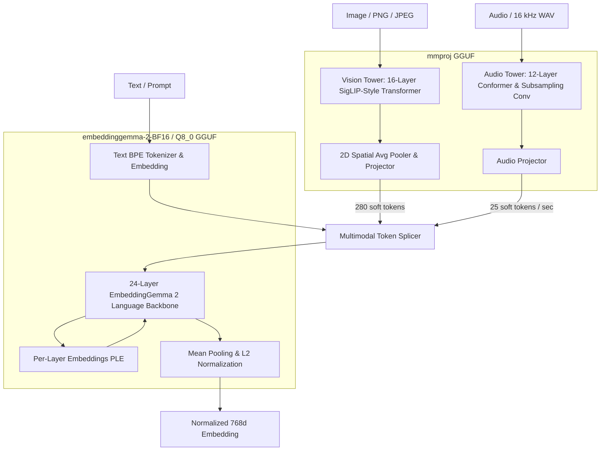

# Multimodal Projector (`mmproj`) Architecture & Implementation

`glypr` implements native, zero-overhead support for multimodal embeddings via dynamic attachment of **`mmproj-embeddinggemma-2-*.gguf`**.

When attached, `glypr` can directly ingest raw images and audio waveforms, map them through independent vision and audio encoder towers, and seamlessly splice soft tokens into the EmbeddingGemma 2 language backbone—all within a single self-contained Rust runtime.

---

## 1. Zero-Overhead Modular Architecture

A fundamental design constraint of `glypr` is **100% zero runtime and memory overhead for text-only workloads**:



- When `mmproj` is **unattached**, only the text backbone is loaded in VRAM/RAM (~540 MB for Q8_0, ~781 MB for BF16).
- When `attach_multimodal_projector(&path)` is called, the 963 multimodal weight tensors (~1.3 GB) are indexed and allocated on the target device on-demand.

---

## 2. Vision Pipeline (`VisionTower`)

The Vision Tower extracts high-level semantic representations from raw image pixels (.png, .jpg, .jpeg, .webp):

1. **Dynamic Aspect-Ratio Preserving Grid:**
   Unlike fixed-resolution models (e.g., $224 \times 224$), EmbeddingGemma 2 dynamically preserves the original image's aspect ratio. Both target height and width are computed to satisfy $H \times W \le \text{budget} \times 9 \times 16^2$ while remaining divisible by $48\text{ px}$ (`side_mult = pooling_kernel_size * patch_size = 3 * 16`).
2. **Rayon Multi-Core Patch Extraction & L1 LUT Normalization:**
   - Raw RGB bytes are partitioned into $16 \times 16$ non-overlapping patches ($P = \text{patch\_width} \times \text{patch\_height}$).
   - Patch extraction is parallelized across CPU threads using `rayon`, reading contiguous 48-byte horizontal slices from `rgb.as_raw()`.
   - Pixel normalization $2 \cdot (x / 255.0 - 0.5) \in [-1.0, 1.0]$ uses a 256-element lookup table pinned in CPU L1 cache, eliminating float division.
3. **Patch Embedder & 2D Position Lookup:**
   GGUF `v.patch_embd.weight` (`[768, 3, 16, 16]`) is permuted to `[768, 16, 16, 3]` and flattened into a linear projection `[768, 768]`, embedding each $16 \times 16 \times 3$ patch into a 768-dimensional token. 2D absolute position coordinates are looked up from `v.position_embd.weight`.
4. **Precomputed 2D Axial RoPE (Zero Synchronization Stalls):**
   Gemma 4 Vision uses 2D axial RoPE with base $\theta = 100$:
   - First half of head dimension ($[0, 32)$) encodes the horizontal ($X$) patch coordinate.
   - Second half of head dimension ($[32, 64)$) encodes the vertical ($Y$) patch coordinate.
   - **Optimization:** Rather than recalculating and uploading $(cos, sin)$ tensors twice per layer across 16 layers (32 GPU $\leftrightarrow$ CPU synchronization roundtrips), $(cos, sin)$ frequencies are precomputed **once** before layer 0 and reused across all 16 layers in VRAM.
5. **16-Layer Transformer Encoder with Fused Metal SDPA:**
   16 Pre-LN Transformer layers featuring $Q/K$ RMSNorm, GeGLU feedforward networks, and bidirectional self-attention:
   - **Metal GPU:** Dispatches to Apple Silicon hardware-accelerated fused SDPA (`candle_nn::ops::sdpa`), eliminating the $82\text{ MB}$ attention weight matrix, $160\text{ MB}$ F32 upcast, and softmax allocations across 16 layers ($> 3.9\text{ GB}$ of transient unified memory allocations avoided per image).
   - **Universal CPU:** Seamless fallback to high-precision float32 softmax attention.
6. **Native 2-Stage Grid Pooling in VRAM:**
   A $3 \times 3$ 2D spatial average pooler reduces spatial resolution by $9\times$:
   - **Stage 1 (Height Pooling):** Reshapes to rank 3 `[out_h, 3, patch_width * hidden_size]` and reduces dimension 1 (`sum(1)`).
   - **Stage 2 (Width Pooling):** Reshapes to rank 4 `[out_h, out_w, 3, hidden_size]` and reduces dimension 2 (`sum(2)`).
   - Keeps all operations $\le \text{rank } 4$ in VRAM, eliminating Candle Metal high-rank reduction limitations and preventing 870k float transfers to CPU.
7. **Projection Head:**
   Unscaled RMSNorm followed by linear projection from 768 to 512 dimensions, matching the language model hidden size.

---

## 3. Audio Pipeline (`AudioTower`)

The Audio Tower processes raw 16 kHz mono waveforms into dense auditory representations:

1. **Log-Mel Spectrogram Extraction:**
   - Sample rate: 16,000 Hz, STFT frame length: 320 (20 ms), hop length: 160 (10 ms), FFT size: 512.
   - Periodic Hann analysis window with 160-sample semicausal left padding.
   - 128-channel HTK triangular Mel filterbank spanning 0 Hz to 8,000 Hz.
   - Log compression: $\log(\text{mel} + 0.001)$. 1 second of audio produces 99 time frames.
   - **Hardware Acceleration:** Multi-core parallel frame streaming using Rayon (`par_chunks_exact_mut`), statically cached 512-point FFT twiddle factors, 9-bit bit-reversal lookup tables, and filterbank matrices via `OnceLock`.
2. **2-Stage Subsampling Convolution:**
   Two successive Conv2D layers (stride 2, padding 1) with channel dimensions $1 \to 128 \to 32$, downsampling the time axis $4\times$ to yield **25 frames per second** (512 dimensions).
3. **12 Conformer Encoder Blocks:**
   Conformer architecture combining:
   - **Macaron FeedForward 1:** Pre-LN $\to$ Up-Proj $\to$ SiLU $\to$ Down-Proj $\to$ Post-LN $\times 0.5$.
   - **Chunked Self-Attention:** Chunk size 12, context window 24 (12 past, 0 future). Relative sinusoidal positional bias with relative shift `_rel_shift`. Precomputed relative key projections (`precomputed_rel_k`) cached in VRAM at model load time; causal sliding-window attention mask cached once in VRAM per clip and passed by reference across all 12 blocks.
   - **Fused Lightweight Conv 1D:** Pre-LN $\to$ Pointwise Linear $\to$ GLU $\to$ Fused 5-Tap Broadcast Depthwise Conv1D $\to$ Conv-LN $\to$ SiLU $\to$ Pointwise Linear. Eliminates 12,288 Candle grouped-conv chunk/kernel dispatches per pass with a single fused multiply-accumulate across the channel dimension ($454\times$ layer speedup).
   - **Macaron FeedForward 2:** Post-layer scale 0.5.
   - **Gemma 4 Clippable Linears:** Every linear operator in all 12 blocks enforces scalar activation clipping bounds (`input_min`, `input_max`, `output_min`, `output_max`) stored directly in GGUF.
4. **Audio Projection:**
   Linear projection from 1536 to 512 dimensions, matching the language model hidden size.

---

## 4. Sequence Assembly & Backbone Forwarding

To embed multimodal queries, `glypr` formats the token sequence using official EmbeddingGemma 2 vocabulary delimiters:

- **Image Query Template:**
  $$\langle\text{bos}\rangle\ \langle\text{boi}\rangle\ \underbrace{\langle\text{image}\rangle \dots \langle\text{image}\rangle}_{280\text{ tokens}}\ \langle\text{eoi}\rangle\ \text{[Optional Prompt]}\ \langle\text{eos}\rangle$$
- **Audio Query Template:**
  $$\langle\text{bos}\rangle\ \langle\text{boa}\rangle\ \underbrace{\langle\text{audio}\rangle \dots \langle\text{audio}\rangle}_{25\text{ tokens / sec}}\ \langle\text{eoa}\rangle\ \text{[Optional Prompt]}\ \langle\text{eos}\rangle$$

Tokens in the placeholder slots ($\langle\text{image}\rangle$ / $\langle\text{audio}\rangle$) are replaced with the soft tokens produced by the respective tower. The merged sequence is forwarded through the 24-layer language backbone with Per-Layer Embeddings (PLE) and mean-pooled across all valid tokens to produce the final 768d unit vector.

---

## 5. Golden Parity & Hardware Acceleration Scorecard

Validated against official Python `SentenceTransformer("google/embeddinggemma-2")` on the deterministic test suite:

| Test Case | Input Modality | Prompt Text | Soft Tokens | Total Seq Len | Target | Measured Cosine Similarity | Status |
| :--- | :--- | :--- | :---: | :---: | :---: | :---: | :---: |
| **Case 1** | Image Only | *None* | 280 | 284 | $> 0.999$ | **0.999839** | ✅ **PASSED** |
| **Case 2** | Image + Prompt | `"Describe this picture"` | 280 | 288 | $> 0.999$ | **0.999704** | ✅ **PASSED** |
| **Case 3** | Audio Only | *None* | 25 | 29 | $> 0.999$ | **0.999644** | ✅ **PASSED** |
| **Case 4** | Audio + Prompt | `"A musical sound"` | 25 | 32 | $> 0.999$ | **0.999852** | ✅ **PASSED** |
| **Cases 15–18** | Dynamic Budgets | *None* | 70–560 | 74–564 | $> 0.999$ | **0.9994–0.9999** | ✅ **PASSED** |

### Latency & Throughput Benchmark (Apple Silicon Metal GPU, Release Profile):

```bash
cargo test -p glypr-core --release --test bench_multimodal --features metal -- --nocapture
```

#### Vision Tower & Card Embedding

| Component / Metric | Baseline (Pre-Optimization) | Optimized (`main`) | Speedup |
| :--- | :--- | :--- | :--- |
| **Vision Tower Only (Budget 140)** | ~200.0 ms | **8.30 ms** | **~24x** |
| **Vision Tower Only (Budget 280)** | ~1,100.0 ms | **12.98 ms** | **~85x** |
| **Total Card Embedding (Budget 140)** | **269.60 ms** (3.71 cards/sec) | **118.23 ms** (8.46 cards/sec) | **2.28x** |
| **Total Card Embedding (Budget 280)** | **1,260.99 ms** (0.79 cards/sec) | **255.34 ms** (3.92 cards/sec) | **4.94x** |

#### Audio Tower & Auditory Embedding

| Audio Clip Duration | Preprocessor (STFT) | Audio Tower (Conformer) | Total End-to-End Latency | Real-Time Factor (RTF) |
| :--- | :---: | :---: | :---: | :---: |
| **1.0s (25 tokens)** | **0.52 ms** (was 2.30 ms) | **6.37 ms** (was 2,896.61 ms, **454x**) | **35.91 ms** | **27.8x real-time** |
| **5.0s (125 tokens)** | **1.52 ms** (was 11.16 ms) | **8.01 ms** (was 3,170.47 ms, **395x**) | **50.99 ms** | **98.1x real-time** |
| **12.3s (307 tokens)** | **3.37 ms** (was 27.12 ms) | **11.74 ms** (was 3,184.88 ms, **271x**) | **97.88 ms** | **125.4x real-time** |

#### Unified Multimodal Image Batching (Budget 140)

Glypr supports unified multimodal batching across arbitrary modalities (pure text, images, audio, interleaved sequences) through `GlyprEmbedder::embed_batch`. Batching leverages multi-core Rayon image preprocessing, batched rank-3/4 ViT encoders, and Objective-C autorelease pool scoping (`AutoreleaseScope`) to completely eliminate transient VRAM leaks:

| Execution Mode | Batch Size | Total Latency | Latency / Image | Throughput | Parity vs Sequential | Peak RSS |
| :--- | :---: | :---: | :---: | :---: | :---: | :---: |
| **Sequential Baseline** | 1 | 2,413.57 ms (32 items) | 75.40 ms / item | 13.26 images/sec | 1.000000 | 2,037.9 MB |
| **Batched (ChunkedSliding)** | 4 | 259.80 ms | **64.95 ms / item** | **15.40 images/sec** | **1.000000** | 2,037.9 MB |
| **Batched (ChunkedSliding)** | 8 | 523.38 ms | **65.42 ms / item** | **15.29 images/sec** | **1.000000** | 2,037.9 MB |
| **Batched (ChunkedSliding)** | 16 | 1,068.99 ms | **66.81 ms / item** | **14.97 images/sec** | **1.000000** | 2,037.9 MB |
| **Batched (ChunkedSliding)** | 32 | 2,215.20 ms | **69.23 ms / item** | **14.45 images/sec** | **1.000000** | 2,037.9 MB |
| **Batched (MetalFlash)** | 8 | 509.55 ms | **63.69 ms / item** | **15.70 images/sec** | **0.999931** | 2,037.9 MB |
| **Batched (MetalFlash)** | 32 | 2,147.53 ms | **67.11 ms / item** | **14.90 images/sec** | **0.999931** | 2,037.9 MB |

---

## 6. CLI Usage

Generate embeddings for images and audio directly using the `glypr` CLI with explicit projector opt-in (`--bf16-mmproj`, `--q8-mmproj`, or `--mmproj-file`):

```bash
# 1. Image embedding with prompt query (BF16 projector)
glypr --bf16-mmproj embed "Describe this picture:" ./scene.png

# 2. Audio embedding without prompt
glypr --bf16-mmproj embed ./recording.wav

# 3. Audio embedding with prompt and Matryoshka dimension truncation (256d)
glypr --bf16-mmproj embed "Acoustic instruments:" ./acoustic_guitar.wav --dim 256

# 4. Custom vision budget (e.g. 140 tokens for native 480x680 card images, 280 default, 560 high-detail)
glypr --bf16-mmproj embed ./card.png --image-token-budget 140
```
